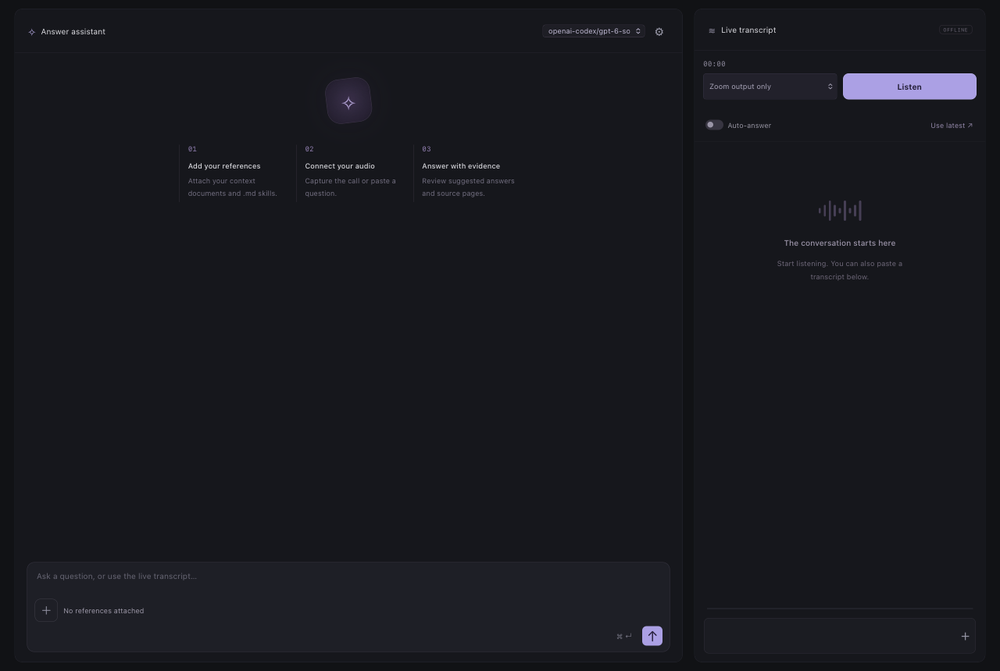

# Ghst

A local desktop assistant for meetings and thesis-defense questions. Ghst transcribes audio and answers questions with your PDF references and Markdown instructions.



The app icon uses an enlarged white ghost on a solid black background, derived from the [supplied ghost animation](https://x.com/stackedlol/status/2112710842865041666). The main app screen does not display the logo. Icon assets reside in `public/assets/ghst-logo.png` and `desktop/ghst.icns`.

## Features

- System audio capture for a Zoom call through the desktop app.
- Microphone or virtual loopback input as a second audio source.
- Speech transcription through the OpenAI API or a local whisper.cpp server.
- Live OpenAI streaming that writes partial words while you speak.
- Answers through omp accounts, the OpenAI API, Ollama, or an experimental custom HTTP connection.
- Local PDF text extraction, with the omp agent reading the extracted pages.
- A local reference library for the saved conversation.
- Answers that cite the reference filename and verified PDF page.
- Full Markdown skill instructions in each answer request.
- Streamed answers, manual questions, and optional automatic answers after speech segments.
- Saved transcripts and questions for later discussion.
- A compact view and a translucent desktop window that stays on top.
- Two main panels, with Settings beside the answer model menu.
- A single-row question field, with reference files and a `+` upload button below it.

The interface follows the reference-library, transcript, and answer workflow of [Natively](https://github.com/Natively-AI-assistant/natively-cluely-ai-assistant). This application contains an independent implementation. It does not include Natively code, branding, or a hidden window.

## Requirements

- Node.js 22.12 or later.
- An answer connection. Use an installed `omp` with a supported account, an OpenAI API key, or an Ollama server.
- A transcription connection. Use an OpenAI API key with API credit or a local whisper.cpp server.
- macOS 14.2 or later for native system audio capture. Windows supports Electron loopback capture. Linux requires a virtual loopback or monitor input.
- Xcode Command Line Tools with the macOS 15 SDK or later to build the Zoom audio helper. The packaged app includes this helper.
- A searchable thesis PDF. Image-only PDFs require optical character recognition (OCR) before upload.

The default answer connection uses your ChatGPT plan's Codex allowance through `omp`. If the subscription fails, Ghst reports the failure. It does not repeat a persistent agent action through another provider. A usage limit or a retry delay longer than 15 seconds stops the answer and shows the reason, because the runtime would otherwise wait hours. Select another answer connection in Settings. OpenAI transcription and direct API answers incur API charges.

## Start the application

Run these commands in this directory:

```sh
npm install
npm run desktop
```

The first command installs the application dependencies. The desktop command downloads the native Electron runtime if necessary. It starts a server on a random loopback port and opens the application window.

On macOS, the source-launch script adds capture descriptions to this project's installed Electron bundle. It does not modify your terminal or system applications. macOS can attribute source-launch audio permissions to your terminal or editor. For a separate application identity, use the standalone app below.

Do not run two application instances with the same data directory. Each instance maintains its own copy of the saved state.

## Create a standalone macOS app

Run:

```sh
npm run package:mac
```

On Apple Silicon, open this application from Finder:

```text
dist/Ghst-darwin-arm64/Ghst.app
```

On an Intel host, the output directory ends with `darwin-x64`. The build uses the host architecture. This local app has no Developer ID signature or notarization. Do not use this command to prepare a public release.

## Configure the application

1. In your terminal, run `omp login openai-codex` and complete the browser sign-in.
2. Open Settings with the gear button beside the answer model menu.
3. Select `ChatGPT — OpenAI subscription through omp` and select `Check connection`.
4. Select `OpenAI API` as the transcription provider and enter your API key.
5. Select the `gpt-live-transcribe` model. This model writes words while you speak. If necessary, enter a language code such as `en` or `pt`.
6. Save the settings.
7. Select `+` below the question field and attach your PDF.
8. Attach your Markdown skill files.
9. Select an audio source.
10. Select `Listen` below `Live transcript`.

For another answer connection or local transcription, use the connection instructions below. Answers and transcription use separate provider settings.

The `skills/` directory includes two optional files:

| File                        | Purpose                                                                   |
| --------------------------- | ------------------------------------------------------------------------- |
| `defense-answers.md`        | Concise answers, research decisions, limitations, and follow-up questions |
| `evidence-and-citations.md` | Source citations, numerical accuracy, and unsupported claims              |

The application applies each attached Markdown file as instructions. Attach only files that you trust. To replace a reference, remove its old copy and attach the new file.

The context library belongs to the saved conversation. The interface has no session tabs or session management controls. Existing saved conversations remain on disk. The application uses the first saved conversation.

## ChatGPT connection through omp

Ghst calls your installed `omp` in non-interactive mode. It selects only the `openai-codex` provider for subscription answers. This provider uses your ChatGPT sign-in. It differs from the `openai` API provider. You do not need the Codex CLI for this connection.

Run `omp login openai-codex` in your terminal to connect your account. Ghst does not copy your authentication tokens into its state or expose them to the interface. Your ChatGPT plan must include Codex access. The plan's rate limits and account policies apply.

`Check connection` checks installed model availability and stored OAuth account metadata. It does not make a paid model request or prove that the current quota permits a new answer. The first answer verifies online access.

The settings panel separates answers from transcription. Local Whisper transcription does not require an API key.

Ghst runs one persistent omp agent for the saved conversation. The agent reads the complete extracted PDF text from `references/` and the Markdown skill text from `skills/`, together with the current instructions. Its native conversation persists across questions and application restarts. The workspace also holds `files/` for working files. The application does not open a second interactive omp window.

PDF references require an omp answer connection. The OpenAI API, Ollama, and custom connections have no file tools, so Ghst rejects an answer that would need a PDF rather than sending a partial PDF excerpt.

Ghst disables ambient context files, LSP, prewalk, memory, and automatic model fallback inside the runtime.

### Automatic conversation management

Questions and automatic transcript answers use the same saved conversation and reference files. The native runtime starts when you submit a question.

Ghst enables native automatic compaction, including maintenance during a turn. It prefers Snapcompact, then tries the native fallback methods when necessary. Snapcompact requires an image-capable model. The runtime decides when the conversation needs compaction; it does not compact after every transcript.

You do not need manual compaction or tool controls. Reference reads stay inside the session workspace and do not require approval. File changes and unexpected interactive requests still require your response. `Cancel answer` stops the current turn and retains the saved conversation.

Ghst does not permit model tools to access files outside the session workspace. Execution, subagent, and browser tools remain unavailable. Old saved trusted-mode preferences do not enable unrestricted access.


### Other connections

Select Claude or Gemini to use the corresponding omp account. Run `omp login anthropic` or `omp login google-gemini-cli`, then enter an exact model ID from `omp models`. Provider access policies apply. Groq uses credentials, not a ChatGPT-style subscription.

For local answers, start Ollama and install a model with `ollama pull <model>`. Select Ollama and enter that model name.

For local transcription, start a whisper.cpp HTTP server with your weights, for example `whisper-server -m /path/to/ggml-base.en.bin --port 8080`. Select Local Whisper and enter its URL. The server loads the weights; Ghst sends complete WAV segments to `/inference`. Ollama does not supply speech transcription.

The experimental custom connection accepts an inline cURL POST template for an OpenAI-compatible endpoint. Use `{{model}}` and `{{messages}}` as complete JSON values. Ghst interprets supported HTTP options without a shell. File reads, command substitutions, and additional commands are prohibited.

The transcription key stays masked until you select the eye button. Edit the field to replace the key. Settings retrieves the key only when you open the dialog.

The default model is `openai-codex/gpt-6-sol`, available in the installed omp model list. To select another model, use its exact ID from `omp models openai-codex`.

Ghst starts each session runtime in that session's workspace directory. It excludes inherited API credentials and disables fallback inside omp. omp still adds its generated workstation and project information to the system prompt.

Each queued question retains its answer connection. If you change that connection before the request starts, Ghst rejects the question. Send the question again with the selected connection.

The installed omp executable remains an external dependency. Install or update omp through your normal installation method. The packaged Ghst app does not bundle or replace omp. Select `Check connection` after you sign in or update omp.

If a subscription answer fails, Ghst shows the error without a second provider request. To use the OpenAI API, select that connection in Settings and supply an API key.

## Capture Zoom audio

### Zoom output only on macOS

1. Open the Zoom desktop app and join the call with computer audio.
2. Select `Zoom output only` in Ghst.
3. Select `Listen`.
4. Grant Screen & System Audio Recording permission to Ghst when macOS requests it.
5. If macOS requires a restart, quit and reopen Ghst.
6. Play remote speech through Zoom and check the input meter and transcript.

This mode selects only Zoom application processes through ScreenCaptureKit. It does not open the local microphone or capture other applications. It stops with an error if Zoom is unavailable. It does not switch to microphone or all-system capture.

Remote participants can return your voice as an echo in Zoom output. Use headphones and Zoom echo cancellation to reduce that echo. Application selection cannot remove a voice that is already part of remote audio.

### All system audio

Select `All system audio` only when you want audio from all applications. This separate mode uses Electron loopback capture. Other applications and microphone monitoring can enter its transcript.

### Microphone or virtual loopback input

1. Select `Microphone / audio device`.
2. Select the input device.
3. Select `Listen`.
4. Grant microphone permission when requested.

A microphone does not directly capture remote Zoom participants. For direct call audio, select a virtual loopback input and route Zoom output to that device. Configure an additional output if you also need to hear the call.

### Browser mode

Run:

```sh
npm start
```

Open `http://127.0.0.1:3210`. A browser can capture only the audio sources that its share dialog supports. For Zoom in a browser, select the Zoom tab and enable audio. The `Zoom output only` mode requires the macOS desktop app. Otherwise, route only Zoom output to a dedicated virtual audio input.

## Answer questions

- Type a question and select the arrow button.
- Use Command+Enter on macOS, or Control+Enter on other systems, to send it.
- Select `Answer this` below a transcript entry to answer that entry.
- Select `Use latest` to edit the latest transcript before you send it.
- Enable `Auto-answer` to answer each complete speech segment from the selected source.
- Read the citation in an answer, such as `(Thesis.pdf, p. 5)`, to check the source page in your PDF.
- Select an answer model beside the Answer assistant title. API choices use API credits.
- Continue the saved conversation to ask follow-up questions after the defense.

Auto-answer is off by default. It processes speech segments, not speaker identities or confirmed jury questions. Pauses can divide a question into multiple segments. All speech from the selected source counts. For more control, keep auto-answer off and edit the question before you send it.

The audio processor detects speech energy and waits approximately 1.15 seconds after a pause. It also divides continuous speech at approximately 22 seconds. For OpenAI transcription, the processor resamples each packet to 24 kHz mono PCM16 and streams it over a local WebSocket while you speak. The `gpt-live-transcribe` model writes partial words into the transcript area before the segment ends. A commit closes the segment, and the completed text enters Live transcript. Local Whisper keeps the complete WAV path. The application stops capture if the stream cannot keep up and reports the problem.

The main window contains only the Answer assistant and Live transcript panels. Settings sits to the right of the answer model menu.

Open Settings to use `Keep window on top` or `Compact view`. These controls apply immediately without `Save settings`. The pin button requires desktop mode.

The compact view keeps the audio controls accessible. The one-row question field has a control row below it. The `+` button and reference label share that row with the shortcut and send button. Attached files appear below the controls.

The question field is 36 pixels high. The attachment and send buttons are each 32 pixels square, with the reference label vertically centered between them.

The desktop window uses 92% opacity by default. Change the opacity in Settings from 50% to 100%. Reference file names retain their complete name in a hover label. Select an inline citation to read the source.

### Custom process label

1. Open Settings in the desktop app.
2. Enter a custom name in `Disguise`.
3. Select the eye button to enable the custom name.
4. Select `Save settings`.

The app saves the name across restarts. Disable the eye button and save to restore `Ghst`. The control changes the app name, window title, and main process label. Operating-system tools can retain the executable name. Renderer and helper processes retain their original names. Browser mode does not support this control.


## Reference limits

| Item                    | Limit or behavior                                               |
| ----------------------- | --------------------------------------------------------------- |
| PDF upload              | 100 MiB per file; eight files per request                       |
| PDF extraction          | 10,000 pages and 50 million extracted characters per file       |
| PDF evidence            | The agent reads relevant extracted pages directly                |
| Markdown skill          | 32,000 characters per file; 64,000 characters across all skills |
| Audio stream            | 24 kHz mono PCM16; three concurrent streams; local Whisper WAV at most 24 MiB and 120 seconds |
| API and local answer history | Up to twelve previous messages within 24,000 characters for OpenAI API, Ollama, and custom requests |
| Transcript context      | Most recent 12,000 characters                                   |
| Conversation            | One active saved conversation; previous saved data remains on disk |

Ghst extracts PDF text page by page and writes it to the agent workspace with `Page N` markers. The agent locates terms with `grep`, then reads the relevant pages with `read`. The original PDF stays on your device and Ghst sends no PDF file to a provider.

The application does not use lexical search, embeddings, or a vector database. Document access is a per-conversation map of extracted documents.

Extraction can lose image-only content, equations rendered as images, and text in charts. Read the cited page before you repeat a claim.

Check each answer against the thesis. Page numbers refer to the physical PDF page, which can differ from the printed page label.

## Local data and privacy

The default data directory is `~/.thesis-assistant`. Set `THESIS_DATA_DIR` before launch to use another directory. The directory contains the saved state, reference originals, extracted text, and temporary uploads.

The server listens on `127.0.0.1` only. It rejects cross-origin requests and unrecognized host headers. It does not return the saved API key through the state endpoint.

The saved API key resides in `state.json`. The application restricts the directory to mode `0700` and saved files to `0600`. The key is not encrypted at rest.

Do not share or commit this directory. Other processes under your user account can read it.

Use `OPENAI_API_KEY` if you do not want the app to save a key. A saved key takes precedence over the environment key.

The application sends data to the selected connections:

| Connection | Data sent |
| ---------- | --------- |
| OpenAI transcription or the configured Whisper endpoint | Live PCM speech frames, segment commits, and transcription options |
| Selected answer provider or endpoint | Your question, recent transcript context, conversation history, and attached Markdown skills |
| omp answer provider | Extracted PDF pages that the agent reads from the session workspace |

Ollama and Whisper process data locally only when you configure services on your device. A remote service receives the data sent to its URL.

The application does not upload the original PDF to an OpenAI file store. It deletes temporary WAV files after each local transcription request. It saves transcripts and answers in the local data directory.

An empty API-key field preserves the saved key. To remove it, quit Ghst and clear the `apiKey` value in `state.json`. This does not remove `OPENAI_API_KEY` from your environment.

Quit the application before you back up or remove its data directory.

## Verification

Run the regression suite:

```sh
npm test
```

The suite covers PDF upload, extraction limits, per-session reference isolation, reference removal, agent workspace synchronization, live speech stream setup and refusal, and complete WAV validation. It also checks that OpenAI API, Ollama, and custom connections reject PDF references before a provider request.
The agent checks cover isolated tool ownership, redirected session directories, RPC frame limits, dialog responses, persistent history, and reference synchronization. They also cover automatic maintenance, consecutive transcript answers, and separate native sessions. Subscription checks cover provider separation, incomplete streams, cancellation, timeouts, and process cleanup.

Local integration checks exercised a generated 180-page PDF, reference persistence after restart, Markdown export, protected key storage, and cross-origin rejection. Browser checks exercised streamed answers, automatic answers, a synthetic audio input through the AudioWorklet/WAV path, and the pending-transcript session guard. These checks used a local OpenAI protocol fixture, not real model inference.

The standalone macOS app also launched successfully. Its compact resize and always-on-top controls worked. A live Zoom call still requires an API key for transcription and operating-system capture permission.

A live omp check answered from an attached test PDF through `openai-codex/gpt-6-sol`. No saved or environment API key was present for that answer. The local API fixture recorded no API answer request. The separate transcription check used a local fixture, not real transcription.

Browser checks verified the selected-model check and saved settings for each provider. The rebuilt macOS app opened with ChatGPT through omp as its default answer connection and detected the configured sign-in.

Persistent-agent failure checks cover quota errors, cancellation, client disconnects, and saved answer history without automatic provider replay. A quota retry now stops the answer within seconds and reports the limit.

A real API request with attached Markdown instructions produced an answer without an irrelevant evidence-gap sentence. That request used the earlier passage-retrieval path and predates the agent-only reference change. The native Zoom helper compiled and its missing-Zoom error path stopped without microphone capture. A live Zoom capture remains unverified.

The 31/10 browser check verified the tab-free interface, equal-size audio controls, centered upload symbol, reference upload, and consecutive transcript answers. It used a local answer fixture, not real model inference. Session creation, rename, deletion, and archived-conversation requests returned 404.

An installed-runtime check confirmed automatic compaction and separate native session identities without a model prompt. The generated configuration preferred Snapcompact. This check did not trigger real compaction or model inference.

Native Electron checks verified compact audio controls at 520 pixels without horizontal overflow. The Settings form changed the main process label, app name, and window title. The custom name survived a restart. Disabling disguise restored `Ghst`. A control-character name failed without a change to the saved name.

A browser check streamed microphone audio to the local stream endpoint and stored the completed transcript. The partial text appeared before the segment ended. Start and stop left no console errors. That check used a local realtime fixture, not real model inference. The regression suite passed all 97 tests.

## Landing page

The static landing page resides in `site/`. It includes an app screenshot, links to the GitHub repository, and the application’s dark, purple, and green palette. It requires no build step.

### Local preview

From the repository root, run:

```sh
python3 -m http.server 18765 --bind 127.0.0.1 --directory site
```

Open `http://127.0.0.1:18765`. Stop the preview with Control+C. Python 3 is necessary only for this preview command.

### Deployment

1. Configure a static host with `site/` as its document root.
2. Add `ghst.f3dz.sh` as a custom domain on the host.
3. Add the DNS record that the host supplies.
4. Enable HTTPS and check the domain.

You need access to the static host and the DNS configuration for `f3dz.sh`. The repository does not configure these services.

Publish only `site/`. Do not expose the local application server or the data directory on the public host.

The primary page action links to GitHub. The repository does not include a signed application download for public distribution.

